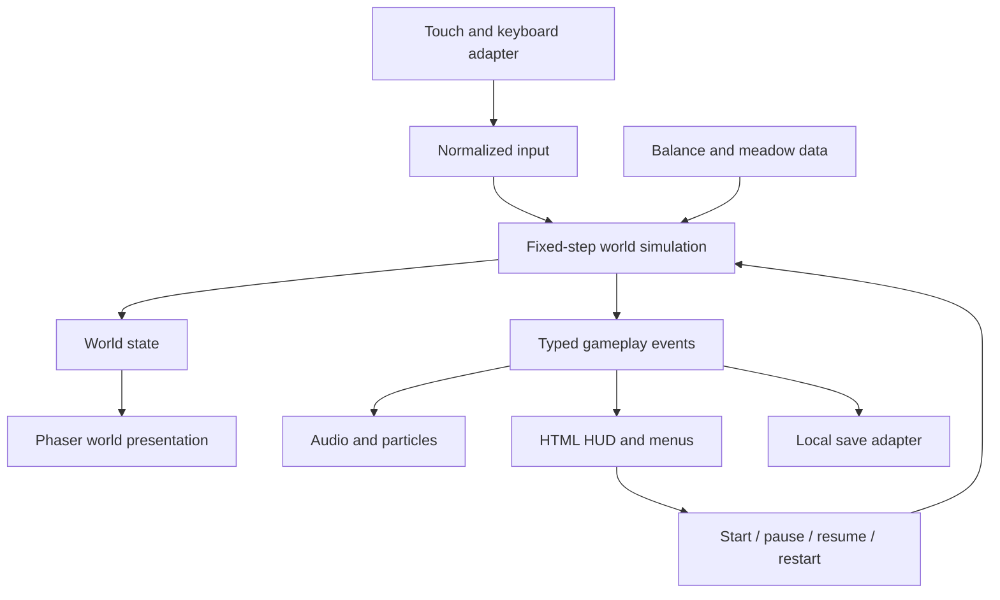

# Lamb on the Lam — product plan and architecture

Status: proposed implementation plan, October 20, 2026. No game or deployment has been created.

## 1. Product direction

A cozy, mischievous survival game for a phone browser. You are an extremely round lamb eating forbidden flowers while a sheepdog tries to return you to your pen. One thumb controls movement. The camera stays close enough to see the lamb's ears, face, wool, and reactions.

The primary promise: **a cute lamb you can actually see, satisfying movement, and a chase that makes you want one more round.**

Design priorities, in order:

1. Responsive movement on a real phone.
2. Readable, expressive character art at the actual gameplay size.
3. Fair and understandable pursuit.
4. Fast start and immediate replay.
5. Small moments of visual and audio delight.
6. Extra modes and progression once the core works.

The prior cat game is not available in this workspace. Treat it as a reference for playful scope; do not assume its technology, artwork, or mechanics.

## 2. The first minute

The title screen contains an animated lamb grazing in a meadow, the title, a large Play button, a sound toggle, and a small settings button.

On the first run, a brief instruction reads: “Drag anywhere to move. Eat flowers. Don't get herded.” The game waits for movement before starting its clock. Flowers lead toward a nearby hiding bush. The dog enters after an introductory grace period, announced by a bark and a directional marker.

During play:

- Walk through flowers to eat them automatically.
- See a small petal burst, a chewing expression, and a score increment.
- Change direction around rocks and bushes to shake the dog.
- Enter a bush and slow down to hide.
- Watch the dog investigate the last place it saw you.
- Leave cover to find fresh flowers and improve the score.

On capture, the lamb sits in offended disbelief while the dog looks pleased. A short animation leads to a result card: flowers eaten, best score, run duration, a verdict, and Play Again.

Example verdicts: “Mostly innocent,” “Known flower criminal,” “Repeat pasture offender,” and “Absolute menace.” Use score thresholds, not random verdicts, so the joke reflects the run.

First-time players should understand movement within ten seconds. An initial tuning goal is 30–90 seconds for an inexperienced player's round, with longer runs possible through skill. Validate this with playtesting; it is not a guaranteed duration.

## 3. Scope and priorities

| Feature | Afternoon prototype | Weekend release | Later |
|---|---|---|---|
| Touch drag and keyboard movement | Yes | Refined | Alternative control presets |
| Close follow camera | Yes | Resize and edge polish | Optional camera preferences |
| Lamb | Charming layered placeholder | Finished character and animation | Costumes and variants |
| Meadow | One open test layout | One authored meadow | New biomes |
| Dog | Basic pursuit | Telegraph, chase, search, recovery | Distinct second dog |
| Flowers and scoring | Yes | Respawn rules and feedback | Flower challenges |
| Bush concealment | Simple | Clearly signaled, counter to camping | More environmental tricks |
| Capture and instant restart | Yes | Animated results and verdicts | Shareable cards |
| Sound | Optional | Effects, mute, short music loop if time | Expanded soundtrack |
| Personal best | Optional | Yes | Local cosmetics |
| Git/Vercel | First playable deploy | Production workflow | Custom domain |
| Public leaderboard/accounts | No | No | Separate backend project |
| Offline installation | No | No | PWA after update handling is designed |

The afternoon target is a playable vertical slice. The weekend target is the smallest polished release. A final bespoke art set, extensive device QA, and all expansion features are not credible as a single afternoon task.

## 4. Controls and mobile behavior

### Touch

Use a floating analog joystick that appears wherever the player starts a drag on the gameplay surface. The starting point becomes its origin; dragging farther increases movement speed up to a cap. Releasing stops movement quickly, with a short visual settling animation.

Initial tuning:

- Joystick travel radius: approximately 48 CSS pixels.
- Dead zone: approximately 7 CSS pixels.
- Full speed reached before an uncomfortable thumb stretch.
- Normalize diagonal movement.
- Reserve DOM buttons for pause and sound; touching them must not initiate movement.
- Track the initiating pointer ID. A second finger must not steal control.
- Clear input on pointer cancellation, release outside the surface, blur, pause, resize, and lost pointer capture.
- Allow comfortable use by either hand without a handedness setting.

Use one pointer event adapter with pointer capture on the play surface. Keep all pointer positions in local CSS coordinates for the joystick; convert only where a world coordinate is needed. Do not attach competing DOM and Phaser movement listeners.

Apply `touch-action: none` to the gameplay surface, not indiscriminately to every page element. Prevent unintended scrolling and selection during play. Keep menu controls accessible with normal DOM behavior.

### Desktop

WASD and arrow keys move; Escape pauses. Click-and-drag may use the same joystick behavior. Capture arrow keys only while gameplay has focus. UI buttons remain keyboard operable.

### Interruptions

Switching apps, hiding the tab, or losing focus pauses gameplay and clears input. Returning shows Resume; it must never fast-forward a chase. A short resumption countdown gives the player time to reposition their thumb.

Orientation changes pause, resize the viewport, clear movement, and offer Resume. Opening a menu does not advance the game clock, hiding timers, or dog cooldowns.

## 5. Camera and screen composition

### Character size is a release requirement

Start with the lamb body approximately 14% of the shorter gameplay viewport dimension. On a 390 CSS-pixel-wide phone, this is roughly 55 CSS pixels before ears and animation. The face must remain readable at that size.

Example camera relationship:

```text
shortSide = min(playfieldCssWidth, playfieldCssHeight)
targetLambCssWidth = clamp(shortSide * 0.14, 44, 104)
cameraZoom = targetLambCssWidth / lambBodyWorldWidth
```

These are proposed tuning values. Measure the body silhouette, not transparent sprite padding. Device pixel ratio affects rendering sharpness, not the desired CSS size.

Use a softly damped follow camera with a small dead zone and modest movement look-ahead. Bias the lamb slightly above the vertical center on portrait phones so the thumb usually sits below it. Avoid constant zoom changes during pursuit.

Near meadow edges, permit the camera to show attractive scenery outside the fence rather than pushing the lamb under the HUD. Decorative outer scenery is not walkable.

### Responsive layout

Portrait phones use the available viewport with safe-area-aware HUD margins. Landscape gets a recomputed zoom based on the shorter dimension. Desktop uses a bounded play panel with decorative surroundings, so a very wide monitor does not expose most of the map or shrink the lamb.

Use a parent container sized with dynamic viewport units and a fallback. Observe its actual dimensions. Phaser's RESIZE scale mode fits its parent, and the camera zoom is calculated separately. See the official [Phaser Scale Manager documentation](https://docs.phaser.io/phaser/concepts/scale-manager).

The screen contains only score, pause, sound, contextual warnings, and the transient joystick. Avoid a minimap, permanent tutorial panels, or inventory.

### Offscreen threat fairness

If the dog is offscreen and within a threat range, show its portrait and an arrow at the nearest safe screen edge. Increase urgency as estimated time to contact decreases. Sound reinforces this but is never the only warning.

Warn before a pursuit burst; initially target at least 1.5 seconds of useful warning before a previously unseen dog could reach the lamb. Clamp the indicator inside the HUD safe region and away from buttons. Never spawn a dog on top of the lamb or inside the active view without an entrance animation.

Screen aspect ratios reveal different areas. For this local-score release, prioritize comfortable play. A future competitive mode must define a consistent effective view or separate rules before comparing scores across devices.

## 6. Rules and balancing

### Movement and collision

Use smooth acceleration with quick deceleration. Start around 240 world units per second for the lamb and tune against the camera and map. Keep collision circles smaller than the fluffy silhouettes; ears and wool should not cause frustrating catches.

Flowers collect on overlap; eating is an animation, not a movement lock. Bushes are passable concealment areas. Rocks and fence edges are solid.

### Scoring

One ordinary flower gives one point. Survival time is reported but does not itself grant score. This prevents hiding indefinitely from becoming the best scoring strategy.

Use a few authored flower clusters with bounded respawning. New flowers appear in eligible empty locations away from the lamb and preferably outside its view. Flowers never spawn inside obstacles. Cap the active count and respawn rate.

Keep the first release's scoring simple. Combos, rare flowers, and risk bonuses can be evaluated after the basic chase is enjoyable.

### Dog behavior

Use an explicit state machine:

| State | Behavior | Exit |
|---|---|---|
| Patrol | Follow meadow waypoints | Detect visible lamb |
| Alert | Bark, turn, show an anticipation cue | Telegraph timer ends |
| Chase | Follow the lamb while visible | Lost sight, exhaustion, or capture |
| Investigate | Move to last seen position | Reach location or regain sight |
| Search | Sniff nearby positions for a bounded duration | Reacquire or give up |
| Recover | Pant and slow down | Recovery timer ends |
| Celebrate | Play capture animation | Round ends |

Base dog speed starts below lamb top speed. Brief, signaled pursuit bursts may exceed it. The dog must turn and recover enough to create escape opportunities. Do not increase its speed indefinitely.

The dog only updates its target from permitted perception. Once the lamb is concealed, pursuit uses its last seen position; the AI must not silently track the current position through cover.

Difficulty increases in discrete, capped stages based on elapsed active play time. Adjust chase persistence and recovery frequency before changing top speed. Keep all values in one configuration file.

### Hiding

Inside a bush, moving below a threshold for approximately 0.3 seconds activates concealment. Show the lamb as a readable translucent silhouette with a small leaf indicator; never make the player's character disappear completely.

If the dog saw the lamb enter, it investigates that bush. Prolonged hiding near the searching dog leads to a signaled sniff/discovery, initially around three seconds. If the dog did not witness entry, it searches the last seen area.

Entering cover does not cancel capture when the dog is already touching the lamb. Concealment has clear entry and exit feedback. This creates a useful escape maneuver without making every bush an invulnerability zone.

### Navigation

Author a small meadow with generous lanes and no narrow dead ends. Start around 2,000 × 1,600 world units and adjust from playtesting.

Use a coarse static navigation grid derived from obstacle geometry, expanded by the dog's collision radius. Direct steering handles unobstructed paths; A* handles blocked routes. Replan at a bounded frequency, such as four times per second, and when the destination changes meaningfully. Smooth unnecessary waypoints.

The afternoon prototype can use an obstacle-free layout and direct pursuit. Add navigation when solid obstacles are introduced. Validate authored spawn points and flower regions against the walkable area.

## 7. Art direction and production

Style: a soft illustrated toy meadow, viewed from a gentle overhead angle. Cream wool, charcoal face, warm green grass, butter-yellow highlights, rounded flowers, soft contact shadows, and very little hard black outlining.

The lamb is the visual centerpiece. Build it from a small number of layered, hand-tuned shapes or sprites: feet, face, wool body, ears, tail, and shadow. This permits squash, bounce, ear motion, and expression changes without a huge sprite sheet.

For the first playable, polished vector shapes exported or baked into textures are acceptable final-looking assets. Avoid generating complex vector paths every frame. Preserve source files for edits.

Character requirements:

- Idle: breathing, occasional blink, ear twitch.
- Moving: alternating foot motion, wool bounce, subtle ear lag.
- Turning: face/ear direction clearly follows heading.
- Eating: quick chew and pleased expression.
- Hiding: crouch and suspicious eyes.
- Near capture: worried glance or ear reaction.
- Caught: seated, scandalized expression.

For the weekend version, four directional poses with shared animation are sufficient if the face reads well. Eight directions are a later refinement.

The dog uses a distinct dark-and-white silhouette, visible legs, and readable anticipation and recovery poses. Never make it visually interchangeable with the lamb.

Environment asset budget:

- One coherent grass ground treatment.
- Three ordinary flower variations.
- Two bush variants.
- Two or three rock variants.
- Fence segments and corners.
- A few noninteractive background details.
- Small petal, dust, and leaf effects.

Use foot-position Y sorting so characters pass naturally behind foreground objects. Fade occluding vegetation around the lamb. Keep high-contrast grass details sparse near important gameplay elements.

Export atlases with enough padding to avoid texture bleeding. Keep editable artwork separately from runtime assets; ship only the optimized runtime files. Record asset origins and licenses in `assets/SOURCES.md`.

## 8. Audio, feedback, and accessibility

Audio set: flower munch, footstep variation, dog alert, sniff, capture, UI click, and a restrained ambient loop if time permits. Cap simultaneous repeated effects. Start or resume audio through a user gesture; persist mute preference.

Use visual cues for all important audio events. Reduced-motion mode removes camera shake, large bounce, and excess particles while preserving state feedback. Default camera shake should be minimal or absent.

Target at least 44 × 44 CSS pixels for UI hit regions and prefer 48 where space allows. Use clear text contrast, visible keyboard focus, labeled controls, and text labels alongside ambiguous icons. Menus and result summaries use semantic HTML.

An optional relaxed mode can reduce dog pressure. Store its best score separately. Do not claim full screen-reader accessibility for the real-time spatial game; make instructions, settings, menus, and results accessible.

## 9. Technology choices

| Layer | Proposed choice | Reason |
|---|---|---|
| Language | TypeScript with strict checking | Explicit state and event contracts |
| Build | Vite | Simple static build and fast development |
| Runtime | Phaser, pinned compatible stable release | Rendering, scene lifecycle, sprites, cameras, audio |
| UI | Semantic HTML and CSS with small TS controllers | A handful of screens does not need a second rendering framework |
| Simulation | Small engine-independent TypeScript modules | Test scoring, perception, and movement directly |
| Collision | Circle and boundary checks in our fixed-step simulation | Sufficient for a few actors and static obstacles |
| Persistence | Versioned localStorage adapter | Personal best and settings without a server |
| Unit tests | Vitest | Exercise gameplay rules |
| Browser tests | Playwright | Start, pause, restart, touch, and layout smoke tests |
| Formatting/lint | Formatter and ESLint | Consistent changes and early errors |
| Repository/CI | GitHub and GitHub Actions | Reviewable changes and checks |
| Hosting | Vercel Git integration | Preview builds and production deployment |

Pin versions and the Node runtime during implementation after confirming compatibility. Commit the lockfile. Use a Node LTS version supported by both the selected Vite version and Vercel.

Phaser supplies unified pointer facilities if engine-managed interactions are needed, but the chosen movement adapter has a single owner to avoid duplicated touch handling. See [Phaser input documentation](https://docs.phaser.io/phaser/concepts/input).

## 10. Runtime architecture



The simulation is the single authority for positions, score, capture, concealment, cooldowns, and round state. Presentation follows that state. Animation callbacks must not award points or determine whether a catch occurred.

The application owns boot, loading, menus, round creation, and fatal error presentation. A Phaser scene owns rendered objects and releases them on shutdown. Avoid independent React state, physics-engine state, and custom simulation state all claiming to own the same entity.

Round lifecycle:

```text
boot → loading → ready → playing → caught → results
                         ↕
                        paused
results → new round → ready
```

The caught state stops gameplay immediately but allows the presentation animation to finish. Results are saved once. Restart constructs fresh round state while reusing loaded assets.

### Simulation timing

Use a 60 Hz fixed simulation step with an accumulator. Render using the most recent state, with interpolation where needed. Cap accumulated catch-up work to approximately five steps per frame and discard excess backlog after severe stalls. Maintain one movement/collision clock; do not also run Phaser Arcade Physics on the same bodies.

All gameplay durations use simulation time. Pause clears input and resets the accumulator. Wall-clock jumps and background suspension never advance a chase.

Proposed update order:

1. Read normalized player input.
2. Move lamb and resolve solid collisions.
3. Determine concealment and visibility.
4. Update dog perception, state, and navigation.
5. Move dog and resolve collisions.
6. Detect capture.
7. If still playing, resolve flower pickups and respawn timers.
8. Emit events and expose the next presentation snapshot.

Resolve the same-tick capture/pickup ambiguity explicitly: capture takes precedence, so no flower is awarded after the round ends.

### Data contracts

```ts
type RoundPhase = "ready" | "playing" | "paused" | "caught" | "results";
type GameMode = "classic" | "relaxed";

interface PlayerInput {
  moveX: number;
  moveY: number;
}

interface RunResult {
  runId: string;
  mode: GameMode;
  seed: number;
  score: number;
  elapsedMs: number;
  verdictId: string;
  rulesVersion: number;
}

interface SaveV1 {
  version: 1;
  bestByMode: Partial<Record<GameMode, number>>;
  settings: {
    muted: boolean;
    reducedMotion: boolean;
  };
}
```

Events include `flowerCollected`, `dogAlerted`, `concealmentChanged`, `roundCaught`, and `roundFinished`. Small typed functions are enough; an elaborate generic event framework is unnecessary.

A seeded random source makes flower placement and test fixtures repeatable. Fixed steps improve reproducibility but are not a promise of bit-for-bit cross-browser determinism.

## 11. Repository layout

```text
lamb-on-the-lam/
  src/
    main.ts
    app/
      lifecycle.ts
      ui.ts
      styles.css
    game/
      createGame.ts
      scenes/
        BootScene.ts
        MeadowScene.ts
      simulation/
        createWorld.ts
        stepWorld.ts
        movement.ts
        collision.ts
        perception.ts
        dogBrain.ts
        navigation.ts
        flowers.ts
        scoring.ts
        types.ts
      presentation/
        LambView.ts
        DogView.ts
        MeadowView.ts
        CameraRig.ts
        ThreatIndicator.ts
        effects.ts
      input/
        InputController.ts
      data/
        balance.ts
        meadow.ts
      audio/
        AudioController.ts
    platform/
      storage.ts
      visibility.ts
      viewport.ts
  public/
    assets/
    favicon.svg
    social-card.png
  assets/
    source/
    SOURCES.md
  tests/
    unit/
    browser/
  docs/
    PLAN.md
    ART_DIRECTION.md
    PLAYTEST_NOTES.md
  .github/workflows/ci.yml
  index.html
  package.json
  package-lock.json
  vite.config.ts
  tsconfig.json
  vercel.json
  README.md
```

This is a target organization, not a requirement to create dozens of empty modules before the first playable. Split files as responsibilities become real. Keep the plan and art checklist alongside the source.

## 12. Persistence and failure behavior

Save only settings and best score initially. Read storage through a small adapter that validates schema and catches malformed JSON, blocked access, and quota failures. If saving fails, the game still works for the current session.

Do not write every frame. Save settings when changed and results once per completed round. Add a visible Reset Progress option in settings with a confirmation because that deletes the player's local record.

Asset loading failures show a readable Retry button. Failure to create a renderer shows a clear message rather than a blank canvas. WebGL context loss pauses the round and offers a safe recovery or restart path; never let invisible gameplay continue.

Keep listener cleanup explicit so repeated restarts do not multiply touch handlers, audio voices, or timers.

## 13. Performance budgets

These are targets to measure on the selected real devices, not present results:

| Metric | Initial target |
|---|---|
| Rendering | Mostly 60 FPS on a representative midrange phone |
| Slower devices | Stable and playable near 30 FPS |
| Initial compressed transfer | Approximately 3 MB or less |
| Entire initial game asset set | Approximately 5 MB or less |
| First playable on a defined throttled mobile profile | Approximately 4 seconds or less |
| Restart with assets loaded | Under 300 ms, excluding optional animation |
| Active actors | One lamb, one dog |
| Simultaneous particles | Initial cap around 80 |
| High-density rendering | Start with DPR capped at 2, lower if profiling requires |

Profile texture memory as well as download size. A small compressed image can decode into a large texture. Prefer modest atlases, pooled particles, static scenery, and limited overlapping transparency. Keep pathfinding and DOM HUD work off the per-frame hot path where possible.

Reduce particles and render resolution before compromising input responsiveness. Do not rerender the entire HUD every frame; update score on change and displayed time at a low frequency.

## 14. Git-to-Vercel delivery

Use a GitHub repository named `lamb-on-the-lam`, with `main` as the production branch and short-lived feature branches.

Vercel supports Git-triggered preview deployments and deployments from the production branch. Connect the repository through its native Git integration. See [Vercel Git integration](https://vercel.com/docs/git).

Planned project configuration:

```json
{
  "$schema": "https://openapi.vercel.sh/vercel.json",
  "framework": "vite",
  "buildCommand": "npm run build",
  "outputDirectory": "dist"
}
```

Use `npm ci` for reproducible installs, and make `npm run build` perform TypeScript checking followed by the Vite build. The initial game lives at `/`; menus are application states, so a catch-all rewrite is unnecessary. Add route-specific deployment handling if real client-side routes are later introduced. Refer to [Vercel's Vite guidance](https://vercel.com/docs/frameworks/frontend/vite) and [Vite static deployment documentation](https://vite.dev/guide/static-deploy.html).

Delivery sequence:

1. Create the repository and commit the smallest runnable game.
2. Import that repository into the intended Vercel account/team.
3. Confirm build settings, supported Node version, and production branch.
4. Open the preview on an actual phone immediately.
5. Enable required CI checks on pull requests before merging into `main`, subject to repository settings available for the chosen account.
6. Merge a tested change to publish production.
7. Smoke-test the production URL, especially asset loading, touch controls, and restart.

Native Git deployment and GitHub Actions run independently. A passing Vercel build does not prove that tests passed. Use required checks and branch protection so failing changes cannot normally reach `main`; do not assume Vercel automatically waits for arbitrary workflows.

CI runs install, lint, typecheck, unit tests, production build, and browser smoke tests against the built site. Upload failure screenshots/traces. Run heavier browser coverage for release candidates.

Runtime secrets are unnecessary for version one. Never put future private credentials in browser-exposed build variables. Use hashed filenames or versioned atlas paths when applying long-lived asset caching. Keep HTML updateable. Defer service workers to avoid stale application/asset combinations during the first release.

For a broken release, use the available Vercel rollback flow or revert the commit on `main` and let Git redeploy. Reconcile Git with any emergency dashboard rollback before the next release.

Account access and Git-provider authorization are setup dependencies to verify when implementation starts. This plan does not assume a connected Vercel account, an existing repository, a paid plan, or a custom domain.

## 15. Verification and acceptance criteria

### Focused automated tests

- Movement magnitude is equal along axes and diagonals.
- Collision prevents crossing solid boundaries.
- Hidden lamb positions do not update the dog's last seen target.
- Dog state timers and bounded recovery behave correctly.
- A flower can award score only once.
- Capture wins over same-step pickup.
- Pause freezes all gameplay timers.
- Restart resets the world and does not duplicate listeners.
- Malformed or unavailable storage does not prevent play.
- Seeded flower placement remains in valid regions.

### Browser smoke tests

- Load `/`, start, move with keyboard, pause, resume, get a result, restart.
- Drag with touch emulation; cancel the pointer; verify movement clears.
- Open menus without moving the lamb.
- Resize portrait to landscape and recover without a stuck input.
- Reload and retain settings and a completed best score.
- Simulate an asset failure and verify the Retry state.
- Confirm no critical console errors or missing assets in the production build.

### Real-device matrix

| Device/profile | Priority checks |
|---|---|
| Small iPhone with Safari | Thumb comfort, browser bars, safe areas, audio, interruption |
| Larger iPhone with Safari | Sharpness, viewport sizing, one-handed play |
| Midrange Android with Chrome | Frame pacing, memory, input latency |
| Tablet | Character size and restrained viewport |
| Desktop Chrome/Firefox/Safari as available | Keyboard, resizing, focus, audio |
| Narrow 320 CSS-pixel viewport | UI fit and readable results |

Browser emulation cannot certify phone audio behavior, thermal performance, or touch comfort. At minimum, test one real iPhone and one real Android before calling the release mobile-polished.

### Playtest questions

Ask a few people to play without coaching. Watch whether they understand movement, notice the dog warning, recognize concealment, attribute a catch to a comprehensible mistake, and choose to replay. Record observations before changing balance.

### Release gate

- Lamb expressions remain readable during movement on a phone.
- No page scroll, stuck movement, or accidental button activation during play.
- Dog cannot appear from outside the view and catch the player without useful warning.
- The route around every solid obstacle works for both actors.
- Hiding helps but does not dominate scoring.
- Pausing and app switching never cause an unseen catch.
- Twenty restarts do not visibly increase objects, handlers, or audio voices.
- Sound settings persist and gameplay works while muted.
- Vercel production loads directly and after refresh.
- The intended Git branch reliably triggers the intended deployment environment.

## 16. Implementation phases and estimates

Estimates are planning ranges for one developer familiar with the tools. Art iteration and real-device issues are the main uncertainty. Do not treat the most optimistic estimates as commitments.

| Phase | Work | Approximate effort | Exit condition |
|---|---|---:|---|
| 0. Foundation | Vite, TypeScript, Phaser, Git, first Vercel deploy | 0.5–1.5 h | A phone can open the preview |
| 1. Feel | Lamb, touch/keyboard, close camera, viewport behavior | 1.5–3 h | Movement and character size feel right |
| 2. Core loop | Flowers, simple dog, capture, restart, score | 2–3 h | Complete repeatable round |
| 3. Decisions | Bushes, perception, navigation, capped difficulty | 2–4 h | Player can deliberately escape |
| 4. Presentation | Finished character, meadow, effects, results, sound | 3–6 h | Cohesive game at phone scale |
| 5. Release | Persistence, tests, device QA, tuning, deployment docs | 2–4 h | Release gate passes |

A roughly 4–7 hour afternoon can produce a focused first playable with simplified art and pursuit. The complete weekend target is closer to 11–22 focused hours; highly custom artwork or device bugs can extend it.

Build order is dependency-driven. Do not spend hours on more maps before the movement, camera, and pursuit feel good. Put the first phone deployment near the beginning, not the end.

If time slips, cut music, hats, extra flower types, decorative animation, and sharing. Preserve input quality, lamb readability, fair warnings, pause behavior, and replay.

## 17. Expansion roadmap

### First expansion: personality and replay

- Three unlockable hats, earned locally.
- An album of verdicts.
- A second dog with a distinctive behavior, introduced only after one-dog balance works.
- A short “BAAA” maneuver only if playtesting finds a second action worth the extra control.
- A shareable result card generated from score, verdict, and character art.

### Second expansion: authored challenges

- Daily seeded meadow challenge with a pinned rules version.
- A timed picnic raid mode.
- A relaxed exploration mode with collectibles.
- Meadow variations such as orchard, rainy garden, and moonlit pasture.

Daily layouts should depend on a documented UTC date and stable seed rules. Local clocks can be manipulated; treat this as a casual feature until a trusted service exists.

### Third expansion: connected features

If public leaderboards become desirable, add a small API and persistent datastore as a separately scoped project. A browser-submitted score is untrusted. Rate limiting and sanity checks reduce abuse but do not establish score validity. Competitive rankings require server verification or a suitably reproducible replay-validation design.

Keep secrets server-side, validate input, define retention, and separate scores by game mode and rules version. Gameplay should continue when the service is unavailable.

### Fourth expansion: installation

Consider a manifest and offline caching after the deployment model is stable. Cache a complete compatible asset set, provide an update prompt between rounds, and test migrations and interrupted updates. Never replace game assets halfway through a run.

## 18. Main risks and decisions

| Risk | Planned mitigation |
|---|---|
| Close camera feels unfair | Advance warnings, capped dog bursts, generous escape routes |
| Lamb is cute in artwork but unreadable in play | Review it at 44–60 CSS pixels before producing more art |
| Thumb obscures action | Floating joystick, character bias, concise HUD |
| Landscape changes visibility | Short-side scale policy; defer competitive cross-device ranking |
| Dog gets stuck | Simple authored map, collision-aware navigation, route tests |
| Hiding makes the game trivial | Flower-only score, last-seen investigation, signaled sniff |
| Game is repetitive | Add meaningful route choices before adding content volume |
| Mobile browser interruptions break the round | Unified pause lifecycle and input reset |
| Custom art consumes the weekend | Layered character, limited asset palette, polish the lamb first |
| Preview looks good but production is broken | Test the built artifact and production URL |
| New deploy causes stale assets | Version assets; defer service worker |

The first implementation milestone is specific: **a Vercel preview on a real phone where a large, expressive lamb moves comfortably under one thumb, eats flowers, and gets chased through a complete restartable round.**
